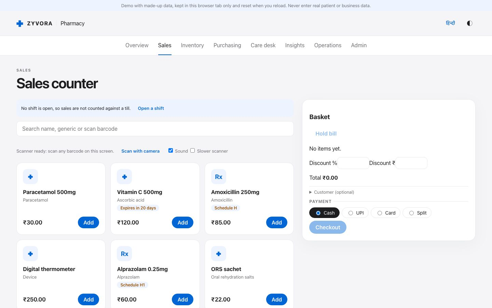
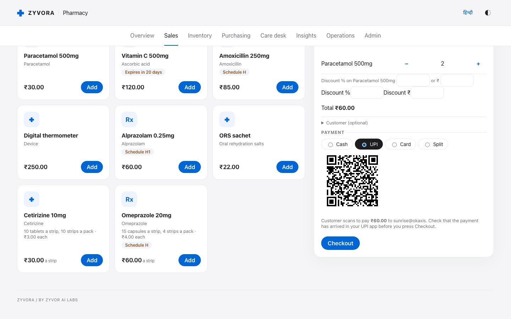
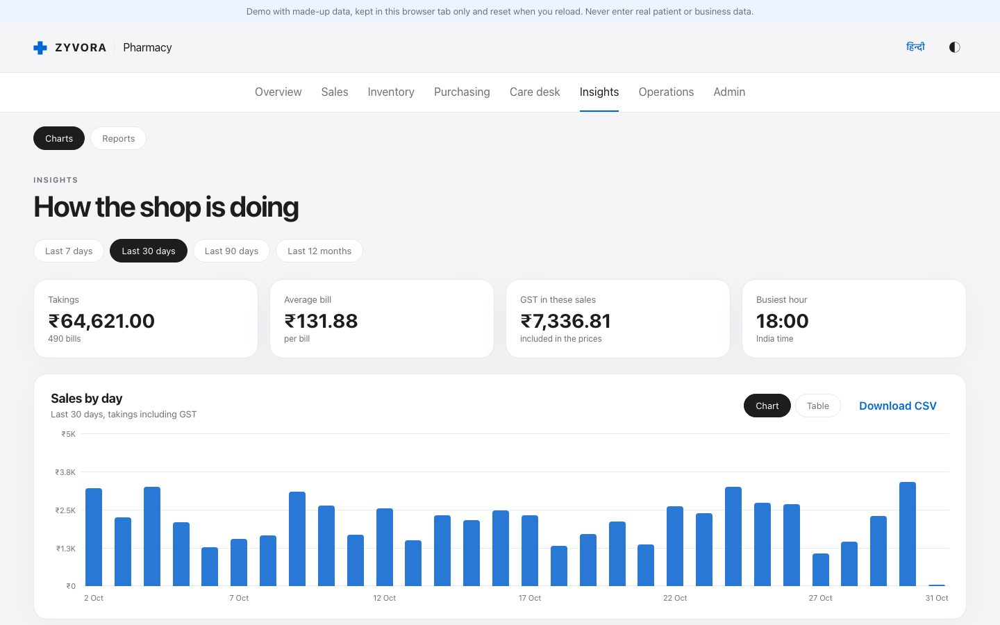
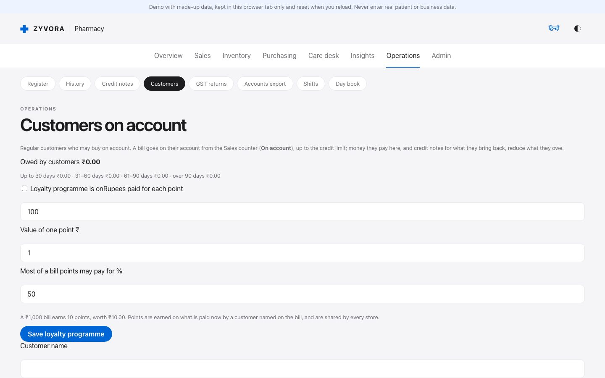
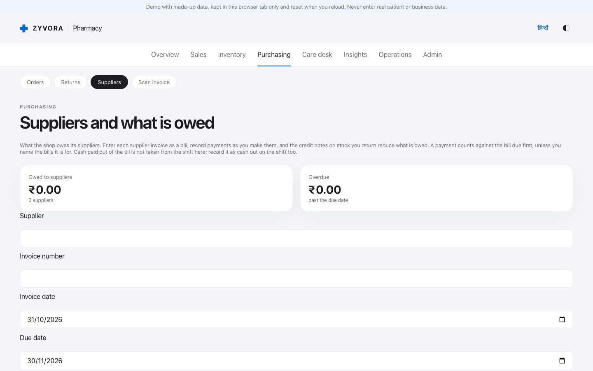
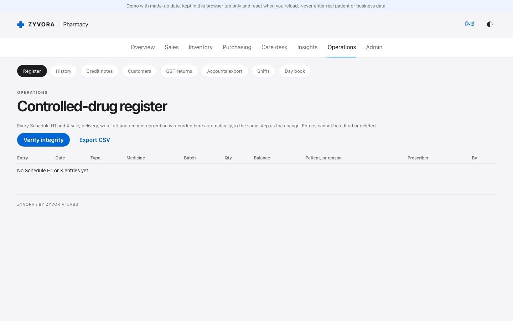

# Zyvora Pharmacy

**The pharmacy counter, done right.** A pharmacy counter and stock system for India: sell with GST, keep stock by batch and expiry,
collect UPI payments at the counter, run customers on account, and keep the controlled-drug register. One codebase runs as a
desktop app (macOS today; Windows and Linux are not yet verified) and as a web app on Kubernetes. English and Hindi, light and dark.

**Try it:** [guided trial](https://zyvorai.github.io/zyvor-pharma-site/try/) · [browser demo](https://zyvorai.github.io/zyvor-pharma-site/demo/) · [website](https://zyvorai.github.io/zyvor-pharma-site/)

The demo runs entirely in your browser with made-up data. Nothing is sent anywhere and it resets when you reload. Never type real
patient or business data into it. The source code is private; this repository holds the website and the demo.

`Release 0.1.0 pilot` · `pharmacy` · `India` · `GST` · `UPI` · `Schedule H1` · `batch and expiry` · `desktop and web`

## See it

| The counter | UPI QR for the exact amount | Insights |
|---|---|---|
|  |  |  |

| Customers on account | Purchasing and suppliers | Controlled-drug register |
|---|---|---|
|  |  |  |

More screens, in light and dark, are on the [website](https://zyvorai.github.io/zyvor-pharma-site/#see). All data shown is fictional.

## Why pharmacies choose it

- **Bills that are right the first time.** GST per line and per rate, the earliest-expiry batch picked for you, and an expired pack can never be added.
- **Never run out, never expire.** Reorder suggestions come from how fast each product really sells; near-expiry and slow-moving lists show what to move.
- **Get paid faster.** A UPI QR for the exact amount, customers on account with credit limits and payment terms, and a WhatsApp reminder for what is overdue.
- **Ready for the inspector.** A hash-chained Schedule H1 and X register, prescriptions with the prescriber recorded, and an audit log.
- **Know how the shop is doing.** Insights, reports, a day book and a cash-drawer count for every shift.
- **From one store to many.** Per-store stock, bills and register, transfers, a store-wide discount and reports across all stores.

## What it does

| Area | What is built |
|---|---|
| **The counter** | Barcode, GS1 DataMatrix, camera or name search; Schedule H/H1/X rules; discounts per product, per bill or per store; free-unit schemes; cash, UPI, card or split payment; customers on account; loyalty points; print, PDF and WhatsApp bills |
| **Stock and expiry** | Batches with expiry and cost, packs in strips and loose tablets, near-expiry and slow-moving lists, substitutes by salt and strength, receiving by scan |
| **Purchasing** | Purchase orders, receiving, an invoice reader (photo or PDF), supplier bills with GST, payments, statements and ageing, price history, returns with credit notes |
| **Customers and credit** | Credit limits and payment terms in days, opening balances, receipts, statements, ageing, write-offs, customer returns with GST credit notes, refill reminders |
| **Controlled drugs** | Append-only, hash-chained H1/X register with balances per batch, CSV for an inspector |
| **GST and accounts** | GSTR-1 and GSTR-3B figures, a GSTR-2B match, e-way bill JSON, e-invoice JSON that records the portal's IRN, sales register, Tally voucher export |
| **Reports and insights** | Takings by day, hour and payment method, top products, GST by rate, busy hours, owed by customers and to suppliers |
| **Shifts and cash** | Float, cash in and out, a counted close that must be explained, a day book you can send to the owner on WhatsApp |
| **Many stores** | Transfers, store switcher, per-store bill details and standing discount, chain-wide reorder suggestion |
| **Security and operations** | Roles, two-step sign-in, optional single sign-on, audit log, encrypted backups with a restore check and off-site copies, metrics and alert rules |

## Where it runs

| | |
|---|---|
| Desktop | A Tauri app with a local SQLite database; works offline. Checked on macOS. |
| Web | A Fastify API on PostgreSQL behind an nginx web tier; Docker images and a Helm chart for Kubernetes. |

45 database migrations, each tested on SQLite and PostgreSQL, and more than 4,500 automated tests, including the real desktop app and
accessibility scans (WCAG 2.1 AA) in light and dark.

## Honest limits

This is a pilot, and the website says what is not done as plainly as what is. In short:

- Not a compliance certificate. No pharmacist or CA has reviewed the GST invoices or the register yet, and there has been no independent security review.
- Zyvora **files nothing** and is not certified GST software. The GSTR-2B match and the exports have not been checked against a real portal.
- UPI is a QR: Zyvora **cannot see that money arrived**, so the cashier confirms in the shop's UPI app. No payment gateway and no SMS sending.
- Scanners, the camera and thermal printers are tested with simulated input; **no real printer or scanner** has been tried.
- No bundled clinical database; the shop enters its own interaction rules. No direct importers for Marg, Busy or Tally yet.
- Signed, auto-updating installers are not published yet; Windows and Linux desktops are not verified.
- One PostgreSQL database and no high availability. Not a hosted service.

The full table is on the [website](https://zyvorai.github.io/zyvor-pharma-site/#honest).

## Contact

Sales and pilots: <sales@zyvor.dev> · Security questions: <security@zyvor.dev> · or open an issue on this repository.

© Zyvor AI Labs. The demo is provided for evaluation only.
